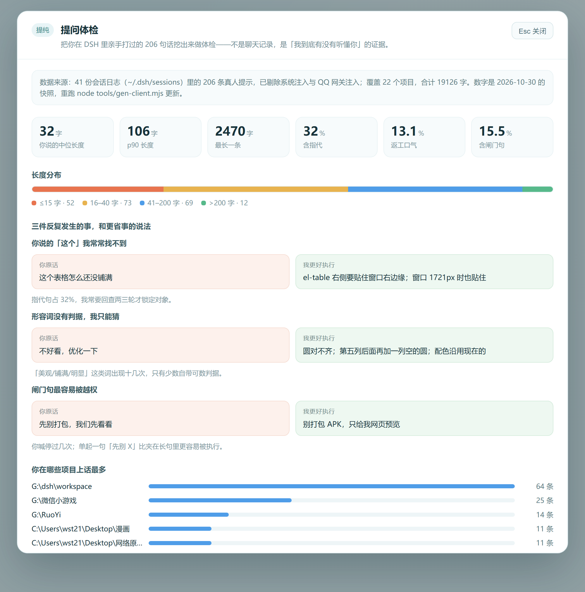

# 提纯 · 提问体检（dsh-prompt-doctor）

把 DeepSeek Harness 会话日志里**真人打过的字**挖出来，做一次量化体检，并以一条斜杠命令唤出一整页报告。

不是让你读更有礼貌，而是让你看清：你的提问有多短、有多依赖「这个/那个」、有多少次是在返工。



## 怎么用

输入 `/` → 选 **提问体检** → 弹出整页报告；Esc 或点背景关闭。

不在输入框上方常驻任何东西——它只在你叫它的时候出现。

## 它挖的是什么

`~/.dsh/sessions/<编码项目>/session-<uuid>/session.v4.jsonl.zstd` 是**多帧拼接的 zstd**（不是单帧）：

```
28 b5 2f fd ... 28 b5 2f fd ... 28 b5 2f fd ...
```

`zlib.zstdDecompressSync` 只解第一帧，streaming API 解到第二帧就报 `Unknown frame descriptor`。正确做法是扫描全部 magic 偏移，逐帧解压再拼接。本项目 `lib/audit.mjs` 的 `decodeSessionFile()` 就是这么做的（实测单文件 2525 帧、0 坏帧）。

解出来的 JSONL 里，`user/message` 事件的 `data.content[].text` 才是正文；但**不是每条都是人写的**——QQ 网关会注入角色卡，DSH 会注入运行上下文。所以还要按 `NOISE` 名单过滤：

`【当前时间】`、`【你的身份】`、`# 角色卡：`、`【最近刷到的东西】`、`【会话令牌】`、`Current runtime context`、`Time sampled`、`<system-reminder>`、`<hindsight_knowledge`、`Browser time zone`、`[Compressed conversation section]`

## 体检口径

| 指标 | 判据 |
| --- | --- |
| 极短 | ≤15 字 |
| 带指代 | 这个/那个/这里/它/还是/又/刚才/上面… |
| 返工标记 | 不是/不对/重新/为什么/怎么还/还没/我说过 |
| 闸门句 | 先别/别急/不要/暂停/停止/禁止/先不 |
| 情绪 | `!`、啊吧呢、哎、卧槽、服了 |
| 验收词 | 跑起来/能用/打开/成功/正常/对得上/不报错 |

最新一次自测（2026-10-30，本机 41 份会话日志）：

```
204 条真人提示 / 22 个项目 / 41 个会话文件
中位 31 字，p90 105 字，最长 2470 字，合计 18973 字
指代 31.4% · 返工标记 12.7% · 闸门句 14.7% · 情绪 30.4% · 极短(≤15字) 25.5%
```

## 装法

没有 `plugin_manager` 工具时，手工装（三步，都要备份）：

```bash
P="$HOME/.dsh/profiles/desktop"
cp "$P/package.json" "$P/package.json.bak"
cp "$P/cordis.patch.yml" "$P/cordis.patch.yml.bak"

# 1. 依赖 + bundle 列表
node -e 'const fs=require("fs"),f=process.env.HOME+"/.dsh/profiles/desktop/package.json";
const p=JSON.parse(fs.readFileSync(f,"utf8"));
p.dependencies["dsh-prompt-doctor"]="link:G:/提纯/plugin";
if(!p.dsh.profile.bundles.includes("dsh-prompt-doctor"))p.dsh.profile.bundles.push("dsh-prompt-doctor");
fs.writeFileSync(f,JSON.stringify(p,null,2)+"\n")'

# 2. 软链
ln -s "G:/提纯/plugin" "$P/node_modules/dsh-prompt-doctor"

# 3. 挂载行
cat >> "$P/cordis.patch.yml" <<'EOF'
- insert:
    - id: prompt-doctor
      name: dsh-prompt-doctor
EOF
```

然后**重启 DeepSeek Harness**（patch 在启动时读取，改文件不会热生效）。

## 结构

```
index.js              Host 半：注册 prompt_audit 工具（动态 import + try/catch，缺包只降级不崩）
client.js             Client 半：输入框上方的卡片，由 tools/gen-client.mjs 生成
lib/audit.mjs         解码 + 过滤 + 统计 + 报告文本
tools/report.mjs      node tools/report.mjs 直接跑体检
tools/card.template.js  卡片模板（含 /*__SNAPSHOT__*/ 占位）
tools/gen-client.mjs  重算快照并烘进 client.js
locale/{en,zh}.json  插件标题与描述
icon.svg             插件图标
```

页面上的数字是**快照**（烘在 client.js 里），Client 半读不到文件系统，这是刻意的：渲染快、无权限问题、数字可追溯。想更新就重跑：

```bash
node tools/gen-client.mjs && git diff client.js
```

## 洞

- 只统计 `source.kind === 'user'` 的事件，子代理会话里的「用户」其实是主代理，可能混入少量非人类文本。
- 指代/返工是正则近似，不是语义判断；「又」既可能是返工也可能是「又要」。
- 会话目录名编码规则：盘符冒号去掉、分隔符→`-`、每个非 ASCII 字符→`~HEX4`（大写），`--` 是首尾包裹。这套规则来自实测，跨版本可能变。

## 许可

MIT

## v0.2 变更（2026-10-30）

- **对话页里不再有任何 UI**：删掉了 `conversation.composer.dock` 的卡片。
- **入口在顶部**：对话标题栏右侧一个「提问体检」按钮（`conversation.header`），另有斜杠命令 `/tijian`。
- **整页展示**：`shell.overlay` 全屏层，Esc 或点背景关闭；页面开头先说明数据来源与口径，再给三组「你原话 → 我更好执行」的对照，最后是项目分布。
- 预览图：`shot/page-preview.png`（由 `tools/preview.html` 渲染，非截图伪造）。

### 为什么页面要自己解释自己

上一版卡片只有数字，没有一句话说明「这些数字是什么、拿来干嘛」，收到了明确的否决意见。新版的每一块都带一句人话标题，并给出可执行的改法。

### 安装时必须用目录联接（junction）

`~/.dsh/profiles/desktop/node_modules/dsh-prompt-doctor` 必须是**联接**指向本仓库，否则运行的是安装那一刻的快照：

```powershell
$link = Join-Path $env:USERPROFILE '.dsh\profiles\desktop\node_modules\dsh-prompt-doctor'
if (Test-Path $link) { Remove-Item -Recurse -Force $link }
New-Item -ItemType Junction -Path $link -Target 'G:\提纯\plugin'
```

git-bash 里 `ln -s` 在这台机器上会静默退化成复制，改完代码界面不变——v0.1 到 v0.2 卡了半小时就是它。
改成联接后，改 `client.js` → 应用里 Ctrl+R 即生效（Host 半的改动仍需重启）。
