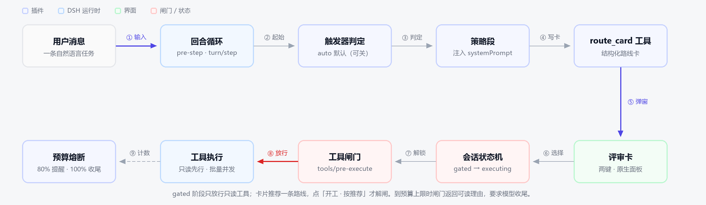
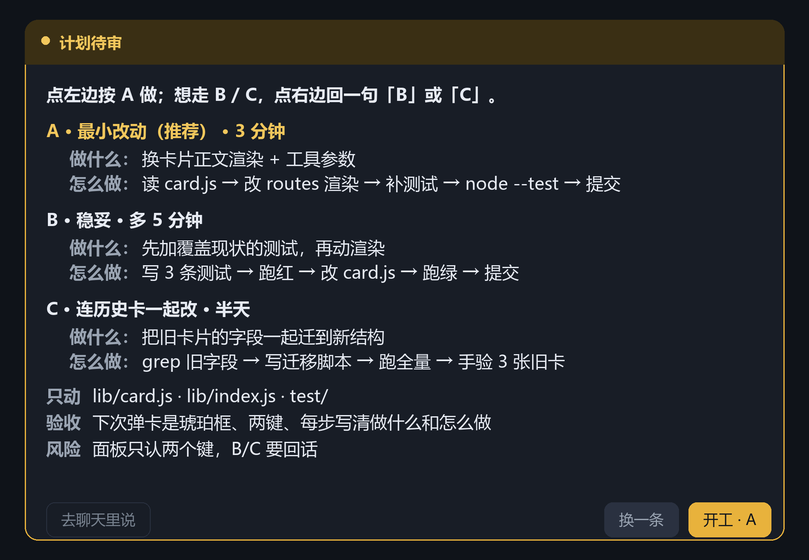

# dsh-route-gate

**先定路线，再动工具。**

DSH（DeepSeek Harness）插件。模型想改东西之前，必须先交一张路线卡——做什么、推荐哪条路、几步、只动哪些文件、有什么风险、屏幕上看什么算完成——你点「开工」，它才真的能调 `write` / `edit` / `bash`。每个回合还有工具调用预算，到点停下汇报。

省的是两样东西：方向错了的返工，和一口气调几十次工具闷头烧掉的 token。



---

## 装了之后差在哪

| 现在 | 装了之后 |
| --- | --- |
| 模型读完需求直接开干，写歪了要等它写完才发现 | 先看一张卡，方向不对一句话打回，一个文件都没动 |
| 提示词里写「先规划」，模型照样跳过 | 闸门在 `tools/pre-execute`，`write` / `edit` / `bash` 返回拒绝，绕不过去 |
| 一个回合几十次工具调用，token 悄悄烧完 | 每回合 12 次（可配）硬上限，到点强制收尾 |
| 计划期一个文件一个文件地探 | 能并行的读取一次发完；`strict` 把只读次数也做成硬拦 |

---

## 装

DSH 的插件是 profile 里的一行 cordis 配置。以桌面端 profile（`~/.dsh/profiles/desktop`）为例：

```bash
# 1. 让 profile 能解析到这个包
cd ~/.dsh/profiles/desktop
npm link "G:/all workspace/插件/调用顺序"      # 发布后改成 npm i dsh-route-gate
```

```yaml
# 2. ~/.dsh/profiles/desktop/cordis.patch.yml 末尾加一行
- insert:
    - id: route-gate
      name: dsh-route-gate
      config:
        trigger: auto
```

重启 DSH 生效（插件在启动时装载，改 `lib/*.js` 也要重启）。

卸载：删掉 patch 里那一块，再 `npm unlink dsh-route-gate`。

<details>
<summary>Windows 本地开发（实测路径）</summary>

profile 里 link 出来的是符号链接，插件解析 `@deepseek-ai/*` 时走的是源目录，所以源目录自己也得能解析到这些包：

```powershell
cmd /c mklink /J "G:\...\调用顺序\node_modules\@deepseek-ai" "$env:USERPROFILE\.dsh\profiles\node_modules\@deepseek-ai"
cmd /c mklink /J "$env:USERPROFILE\.dsh\profiles\desktop\node_modules\dsh-route-gate" "G:\...\调用顺序"
```

</details>

---

## 用

平时不用管它。模型要动东西时会自己弹卡，卡是琥珀色的，跟聊天框分开，卡面长这样：

```
路线卡 · 等你选
──────────────────────────────────────
点左边按 A 做；想走 B / C，点右边回一句「B」或「C」。

A · 最小改动（推荐） · 3 分钟
  做什么：换卡片正文渲染 + 工具参数
  怎么做：读 card.js → 改 routes 渲染 → 补测试 → node --test → 提交

B · 稳妥 · 多 5 分钟
  做什么：先加覆盖现状的测试，再动渲染
  怎么做：写 3 条测试 → 跑红 → 改 card.js → 跑绿 → 提交

只动    lib/card.js · lib/index.js
验收    下次弹卡是琥珀框、两键、每步写清做什么和怎么做
──────────────────────────────────────
       [ 开工 · A ]   [ 换一条 ]
```

两个键的意思：

- **开工 · A** — 按推荐路线执行。改动超出卡里声明的范围时，闸门会重新关上。
- **换一条** — 不执行。你回一句「B」或「C」，模型就换那条路线重出卡。

卡面示意（布局稿，实际配色跟主题走）：



同一件事的命令版：

```
/route          看当前状态（阶段、本回合用了几次、拦过几次）
/route off      本会话关掉闸门（新开会话自动恢复）
/route on       重新打开
```

### 配置

| 键 | 默认 | 说明 |
| --- | --- | --- |
| `trigger` | `auto` | `auto` 改东西前必须过卡；`strict` 再把计划期只读次数做成硬拦；`off` 整行关掉 |
| `turnToolBudget` | `12` | 每回合实际执行的工具调用上限，到了就拦并要求收尾 |
| `planReadBudget` | `4` | 出卡前允许的只读次数，只在 `strict` 下生效 |
| `locale` | `zh` | 卡片、拒绝文案、命令输出：`zh` / `en` |
| `extraMutating` | `[]` | 额外当成「改东西」的工具名，支持 `*` |
| `extraReadonly` | `[]` | 额外当成「只读」的工具名，支持 `*`；只读优先于可写 |

---

## 整体框架

三个落点，全部挂在 DSH 自己的钩子上——不靠模型自觉：

```
用户消息 ─▶ agent/pre-step ──▶ route_card 工具 ──▶ 原生评审面板
                │ 每回合重置状态                    │
                │                                   ├─ 开工 ─▶ approved
                ▼                                   └─ 先改路线 ─▶ 仍 open
        tools/pre-execute
                │
     ┌──────────┴──────────┐
  只读工具               改东西的工具
     │                      │
  放行（strict 下计额度）   未批准 ─▶ deny（返回可读理由，工具不执行）
                        已批准 ─▶ 放行
                              │
                    tools/post-execute ─▶ 计数 +1，到预算后下一次被拦
```

1. **提示词段**（`route-gate:policy`，挂在 `PLAN_POLICY` 之后）— 告诉模型卡里该写什么、被拒了怎么办。这一层让模型主动出卡，而不是撞墙。
2. **`tools/pre-execute` 瀑布** — 返回 `{ kind: 'deny', reason }` 直接短路，工具根本不执行，模型收到 `Error: <理由>`。
3. **`tools/post-execute` 瀑布** — 只统计真正执行过的调用（`result.isError !== true`），被拒的不消耗预算。

状态机：`open` →（批准）→ `approved`；每回合开始回到 `open`；`/route off` 是会话级旁路。

**为什么非要下沉到工具层**：提示词是建议，工具钩子是事实。上面那些「先规划」的工作流，模型不听话就失效；这里的 deny 是宿主管线返回的，模型除了出卡或停下没有第三条路。

---

## 路线

| 阶段 | 内容 | 状态 |
| --- | --- | --- |
| P0 探针 | 用 `tools/pre-execute` + `agent/pre-step` 证明闸门能拦、能按回合重置 | ✅ 0.1.0 |
| P1 闭环 | 路线卡 → 批准 → 放行 → 预算计数 → 超限收尾 | ✅ 0.1.0 |
| P2 体验 | 卡片换成原生琥珀两键面板、推荐路线写进卡面、卡面压缩到一屏 | ✅ 0.2.0 |
| P3 打磨 | 按 token 重量计预算、证据回执（卡里写验收命令，批准后自动跑）、按 cwd 复用历史卡片、探查转 subagent | 下一步 |
| — | 上架 dshmarket、中英双语文档 | 待排期 |

---

## 和 plan-mode 的关系

DSH 自带 `@deepseek-ai/dsh-plan-mode`：`/plan` 进计划模式，模型可以调 `exit_plan_mode` 弹评审。**它是提示词级的**——计划模式里模型照样能调 `write`、`bash`。

route-gate 补的是另一半：

| | plan-mode | route-gate |
| --- | --- | --- |
| 触发 | 你手动 `/plan` | 每回合自动 |
| 约束对象 | 模型的行为（提示词） | 工具调用（闸门） |
| 绕过方式 | 模型不听话就绕过了 | 绕不过，除非你点「开工」 |
| 产物 | 一段计划文本 | 结构化路线卡 + 声明的范围 |

两个一起开不冲突：plan-mode 管「说清楚」，route-gate 管「挡得住」。

---

## 借鉴

- [github/spec-kit](https://github.com/github/spec-kit)（144k★）：阶段闸门 + 每阶段一份产物；
- [cline/cline](https://github.com/cline/cline)（71k★）：Plan / Act 双模式与工具白名单；
- [bmad-code-org/BMAD-METHOD](https://github.com/bmad-code-org/BMAD-METHOD)（55k★）：路线卡字段（目的 / 验收 / 范围 / 风险）；
- [humanlayer/humanlayer](https://github.com/humanlayer/humanlayer)（13k★）：人工审批闸门的确认语义；
- RooCodeInc/Roo-Code（24k★，已归档）：子任务隔离，P3 方向。

差异点：上面这些大多数靠「提示词 + 工作流脚本」约束，route-gate 把约束下沉到**工具执行层**，并且加了**按回合的预算熔断**——这是有工具钩子的宿主才做得到的。

---

## 已知限制

- **未知工具默认放行**：第三方工具不在两份清单里时不会被拦（避免死锁），要拦就加 `extraMutating`。
- **子 agent 共享父会话状态**：subagent 继承父 agent，路线卡由父会话批一次。
- **预算按次数算**：一次 `read` 和一次 `bash` 都记 1 次，不按 token 折算（P3 要改的）。
- **需要 `userQuestions` 服务**：没有这个服务的部署（纯 headless）请设 `trigger: off`，否则 `route_card` 会报错。

---

## 开发

```bash
npm test          # node --test，18 个用例
```

> 沙箱里禁止子进程时，`node --test` 的分进程模式会 EPERM，改：
> `node --test --test-isolation=none test/policy.test.js test/apply.test.js`

```
lib/index.js    插件行：Config、pre-step / pre-execute / post-execute、route_card、/route
lib/policy.js   工具分类与预算算术（纯函数）
lib/state.js    每 agent 的闸门状态机
lib/card.js     路线卡渲染与按钮语义
lib/prompt.js   注入系统提示词的策略段
test/           policy 单测 + 假 cordis 上下文里的端到端用例
```

`test/apply.test.js` 用一个假的 cordis 上下文把插件跑起来：伪造三条链，断言「未批准必拒、批准后放行、预算到点必拦」。改闸门逻辑先跑它。

---

## License

MIT
